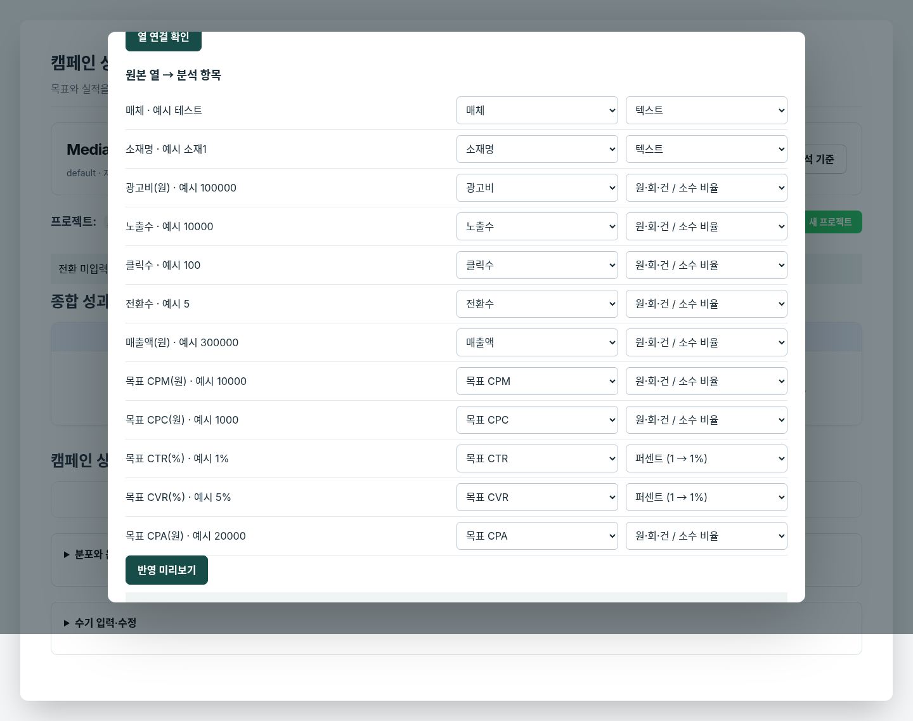
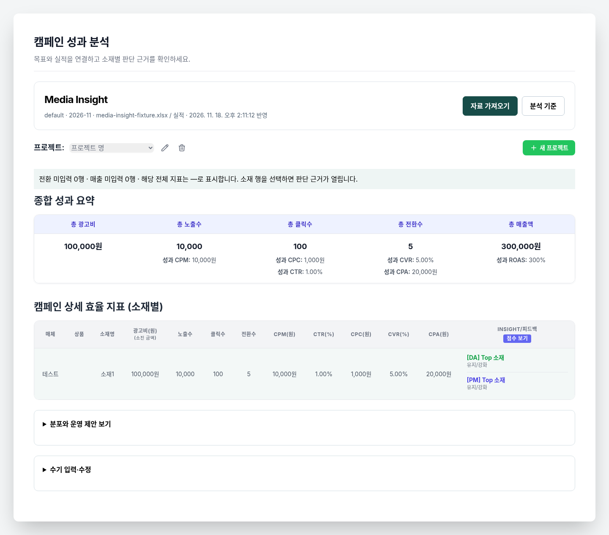

# 테스트 브랜치 구현 및 검증 기록

출발 커밋은 0db6ece8bfbcc47491d788659661d1c20b9537e6이다. 기준 문서는 [작업 지침서](docs/WORK_GUIDE.md)다.

## 구현한 사용자 흐름

‘자료 가져오기’에서 엑셀 파일 또는 복사한 표를 선택하고 기간·자료 성격·제목/데이터 범위를 확인한다. 원본 제목·예시 값을 보면서 분석 항목과 단위를 연결하고 반영 미리보기를 확인한다. 연결은 업체 양식 이름으로 기억할 수 있다. 동일 기간·매체·상품·소재는 갱신하고 중복 행과 겹친 기간은 확인을 요청한다. 기존 기간 없는 행은 전체 교체 방식으로 이전할 수 있다.

계획은 별도로 보관하며 실적 합계에 포함하지 않는다. 소재 목표가 우선이며 매체·상품 계획에서 부족한 목표를 연결한다. 계획 예산·노출·클릭·전환으로 부족한 목표를 역산한다. 명시 목표와 역산값이 다르면 확인 후 명시값을 적용한다. 열이 생략된 갱신 자료는 이전 목표를 유지하고, 연결한 목표 열의 빈 셀은 미입력으로 반영한다.

분석 표가 화면 중심이며 행을 클릭하거나 키보드 Enter로 목표·실적·계산식·점수·목표 출처를 확인한다. 분포와 수기 입력은 펼쳐 볼 수 있다. 분석 기준 변경 시 실제 프로젝트의 전후 점수·등급을 확인하고 적용한다. 기준은 프로젝트별 이름과 버전으로 저장한다.

## 자동 검증

2026-11-18, Linux Chromium + Playwright에서 검증했다.

- `npm test`에서 7개 테스트를 통과했다. 기준 지표, 기존 등급, 경계값, 결측과 0, 단위, 열 재배열, 합계 제외, 반복 반영, 계획 연결, 기간 겹침, 가중 집계가 포함된다.
- `npm run test:browser`에서 붙여넣기와 복수 시트 엑셀 파일, 실제 백분율 셀, 합계 행 제외, 갱신, 취소, 저장 공간 오류 복구, 중복 프로젝트명 방지, 저장 후 복원, 기존 형식 입력값 보존, 근거 화면, 사용자 기준 적용, 매체 계획을 소재 2개에 연결하는 흐름을 통과했다.
- 브라우저 실행 중 페이지 오류는 0건이다. 요청은 정적 자산 GET으로 한정됐으며 자료 업로드 요청은 발생하지 않았다. 엑셀 라이브러리는 로컬 파일로 제공한다. 기존 Tailwind CDN과 Google Fonts 요청은 유지한다.
- `git diff --check`와 새 JavaScript 파일 구문 검사를 통과했다.

수치 기준 행은 광고비 100,000원, 노출 10,000, 클릭 100, 전환 5, 매출 300,000원이다. CPM 10,000원, CPC 1,000원, CTR 1%, CVR 5%, CPA 20,000원, ROAS 300%를 확인했다. 두 번째 행 광고비 20,000원·노출 1,000·클릭 20을 합치면 전체 CTR은 약 1.09%다.

## 의도한 동작 차이

최초 실행은 빈 입력으로 시작하고 기존 예시는 샘플 보기에 둔다. 전환 미입력과 실제 0건을 구분하며, 매출 미입력은 ROAS를 산출하지 않는다. 일부 소재에 전환·매출이 빠지면 전체 관련 지표는 —로 표시하고 누락 행 수를 제공한다. 정상 입력의 기본 채점 임계값은 유지한다.

## 병합 전 남은 확인

실거래처 익명 양식과 Windows Edge/Chrome에서의 직접 확인은 대기 중이다. 자동 인식은 명시적인 제목을 중심으로 지원하며 모호한 제목과 단위는 사용자가 연결한다. 다단 제목은 상위 행을 지정할 수 있다. 병합된 데이터 셀을 소재별로 자동 분배하지 않으므로 필요한 값을 원본에서 보완해야 한다. 기간은 YYYY-MM 또는 YYYY-MM-DD ~ YYYY-MM-DD 형식이다. 파일은 20MB 이하 .xlsx를 지원하며 계산 결과가 저장되지 않은 수식은 안내 후 가져오기를 중단한다.

## 재현 및 복구

개발 검증에는 Node.js와 Playwright가 필요하다. `npm ci` 후 `npm test`를 실행한다. 별도 출처에서 정적 서버를 열고 `MI_TEST_URL`을 지정한 뒤 `npm run test:browser`를 실행한다. 기본 주소는 http://127.0.0.1:8765/ 이다. 브라우저 경로는 `CHROMIUM_PATH`로 지정하고 기본값은 /usr/bin/chromium이다. 화면 증빙 저장 경로는 `MI_ARTIFACT_DIR`이며 기본값은 /tmp/mi-artifacts다. 예를 들어 개발 환경에서 `python -m http.server 8765`로 서버를 실행할 수 있다. 사용자 배포는 정적 파일이며 개발 도구 설치가 필요하지 않다.

가져오기·분석 기준을 처음 저장하기 직전의 데이터는 localStorage의 campaignDashboardStorage:backup에 보관한다. 운영 복구가 필요하면 현재 데이터를 사본으로 보관한 후 이 백업값을 campaignDashboardStorage에 복원하고 페이지를 새로고침한다. 코드 복구는 병합 커밋의 revert로 진행한다. 저장 형식은 기존 projects / MAIN 구조를 유지하며 schemaVersion과 선택 메타데이터를 추가한다.

